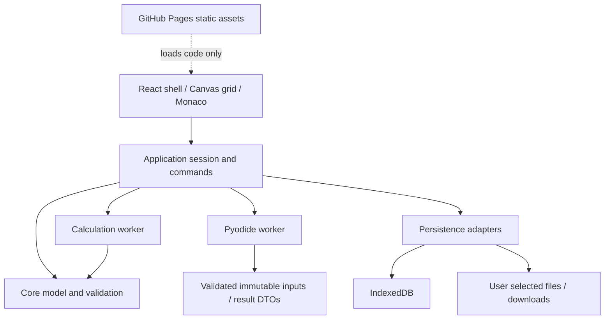

# ExcelLight Web architecture

The React/Vite application opens a dark worksheet backed by the workbook session. S02 verified browser Python for the showcase scripts. S03 verified selected formula semantics and native and XLSX interchange. The following architecture guides the rest of the port.

## 1. Backend decision

**No application backend is planned.** GitHub stores source and runs CI; GitHub Pages serves the static build. React, the spreadsheet engine, file adapters and Python all run in the browser. Workbooks are never uploaded by application code. This is suitable for the requested local-data product.

Exact desktop process parity is impossible under that constraint: browsers cannot launch arbitrary Windows processes, read arbitrary disk paths, or load arbitrary native CPython wheels. Pyodide is the recommended Python implementation, subject to S02 validation. If unchanged scripts require those desktop facilities, retain the desktop app or explicitly reconsider a local companion/server architecture. Do not quietly add a backend or call those scripts supported. A backend would also conflict with GitHub Pages-only execution and the local-data requirement.

## 2. Stack and alternatives

| Area | Recommendation | Reason / qualification |
| --- | --- | --- |
| App | React + strict TypeScript + Vite | Static output; familiar agent tooling; typed boundaries |
| Styling | Shared CSS variables, dark only | Preserve black top bars, dark sheet/panels and blue focus; no styling framework required |
| Worksheet | Custom virtualized Canvas 2D plus DOM editor and accessible grid projection | Existing Win2D semantics are specialized; avoid coupling the model to a commercial grid |
| Model | Pure TypeScript sparse immutable snapshots and command transactions | Port source semantics, not UI framework types |
| Calculation | TypeScript tokenizer/AST, dependency graph and exact supported function subset in a worker | ClosedXML is a .NET dependency, not a drop-in JS engine; prove semantics before implementation |
| Python | Lazy-loaded pinned Pyodide in a module Web Worker | NumPy/pandas/Matplotlib in-browser; use explicit Agg PNG backend; probe pyarrow rather than assuming availability |
| Editor | Lazy-loaded Monaco with locally bundled workers | Preserve source editing, range picking and draft barriers |
| Native format | Version-1 ZIP/JSON adapter with bounded zip.js streaming | Keep desktop .exlt interoperability |
| XLSX | OOXML over zip.js with namespace-aware xmldom for small metadata parts | Preserve the desktop-supported subset, including detailed styles |
| Storage | IndexedDB (thin idb adapter); File API download/upload fallback | Browser-local workspaces and portable files; optional File System Access when available |
| Tests | Vitest + Playwright; differential fixtures from desktop | Domain behavior, actual WASM runtime, browser interactions and static deployment |

The production app uses React and its build and test tooling. S02 adds a separate Pyodide probe and a checksum lock. S03 adds the formula probe and pins zip.js and xmldom for the file adapters. [Formula and file adapter decision](decisions/ADR-003-formula-and-file-adapters.md)

## 3. Components and dependency direction

`core` imports no React, browser APIs or adapters. `application` depends on core and abstract ports. Calculation, persistence and Python implement ports; `app` wires them. `features` translates UI intent into commands. `grid` owns projection and input, never an independent editable data store. Dependencies must not cycle. Large calculation, decode/encode and Python work must not block input.

## 4. State, history and worker contract

- S04 implements the sparse workbook and session in TypeScript. The model stores plain, deeply immutable snapshots and shares unchanged records across transitions. Callers inject an ID factory. Worksheet view state belongs outside the document.
- Indexed cell deltas retain sparse cell order for history. Structural proposals carry a detached workbook with the same workbook ID and can be submitted against a captured basis. The session validates the entire proposal before changing live state. The history byte budget counts estimated retained DTO size in both directions, including structural snapshots.
- The web session issues a compact, session-scoped source fingerprint and compares authored content exactly when checking saved content. Equality ignores derived caches and the enumeration order of sparse cells, axis dimensions, merge records and filter criteria. A confirmed save records the captured snapshot that completed, even if edits advanced the session. A save from a previous session is ignored.
- Native cache batches use the versioned workbook DTO in `src/application/workbook-protocol.ts`. The session checks the pending request and its full basis, then validates the whole update batch before applying it. Cancel, superseding requests, edits and adoption invalidate pending work. Calculators and persistence adapters operate on detached inputs and report completions to the session.
- Retain stable workbook/sheet/cell/block/name identities and one-based coordinates. Separate blank from empty text, finite number, Boolean, native formula and Python anchor. Keep authored source separate from derived caches and UI view state.
- Session owns document, authored identity, saved identity, monotonic revision and bounded history (100 transactions / 64 MiB). Compound edits, structural changes and Python result generations are atomic. Native cache commits advance the full revision without adding history or advancing the authored revision. Clipboard and deferred structural commands use the authored revision to reject intervening edits and use a fresh snapshot when planning their transaction. Undo never rewinds either revision.
- Workers receive immutable snapshots or validated deltas with `protocolVersion`, `requestId`, `sessionId`, `revision`, `generation`, `sourceFingerprint` and `runtimeFingerprint`. Replies must match the current basis and limits before one transaction commits. Ignore late work after editing, undo, load, cancellation or worker replacement.
- Retain source bounds: 10 sheets, 10,000 rows x 100 columns, 200,000 populated cells, 10,000 formulas. Baseline visible projection remains A1:Z1000; expanding it is a separately measured improvement, never required to prove existing parity. Named definitions <=1,000. Python input/output <=100,000 cells, preview <=500 rows, source/logs <=1 MiB, messages <=32 MiB, PNG <=16 MiB and 16 million pixels, default timeout 30 seconds.
- Serialized outputs use validated plain DTOs, typed arrays and transferable ArrayBuffers, not Node files or Windows pipes. JSON-first table transport is acceptable; Arrow is an optimization only if packaged and measured. Preserve values/nulls/date conversion independently of transport.

## 5. Calculation and references

Implement the FormulaSubset allowlist recorded in Feature-Parity. English names/comma separators are canonical; locale presentation only changes actual argument separators. Parsed reference tokens, never search-and-replace strings, drive copy, cut/move, fill, structural edits and rename. Structural edits adjust absolute coordinates too; deleted targets become #REF!. Python xl literals need syntax-aware source spans.

Use explicit error values for circular dependencies (`#REF!`), malformed source (`#VALUE!`) and unsupported functions (`#NAME?`). IF and IFERROR evaluate their selected branch, while dependency analysis records references in every branch. VLOOKUP supports exact and sorted approximate matching as exercised by the desktop calculator. SUBTOTAL excludes filtered rows and nested subtotals, and codes 101–111 also exclude manually hidden rows. Its filter key uses the shared cell formatter, including locale tags and numeric masks. A format change in a filtered column invalidates affected SUBTOTAL formulas. S15 adds filter controls and the filtered-row worksheet projection.

S08 uses the browser locale for numeric and date text coercion. Formula syntax and stored numeric values stay canonical. DATE and the date-part functions preserve serial 60. Inline array constants and array arithmetic can feed an aggregate or return a scalar cache. The 1904 conversion belongs at the XLSX file boundary. S10 verifies date offsets and unchanged clocks and numbers against actual XLSX fixtures. S19 implements production XLSX mapping.

Native and Python Automatic/Manual settings remain independent. The native scheduler debounces isolated edits by 75 ms and compound or queued edits by 220 ms. It coalesces work while a request is in flight, invalidates a superseded reply, and acknowledges only replies accepted by the session. The module worker keeps an acknowledged graph and calculation state, reuses the graph on literal edits, and traverses dirty ranges and downstream dependencies. Formula topology changes rebuild the graph. TODAY uses an injected clock and refreshes once per evaluated generation.

Manual edits keep existing results and mark affected formulas stale. Calculate Sheet refreshes the active sheet's formulas and their transitive precedents. Calculate Now refreshes all native formulas. Any remaining stale formulas retain their markers. Native mode is session-local until S18 adds local preferences. The native scheduler never starts Python. The future mixed generation shares one dependency graph and native context, replans after spill topology changes, executes Python sequentially, and commits atomically. Selection, source drafts, Undo/Redo and Restart never execute scripts.

S07 applies sheet and axis changes as detached session proposals. Whole-axis edits move existing dimensions, merged ranges, filters and defined names with the cells. Lane shifts can split formula ranges into unions. A named extent that becomes disjoint retains its identity and is marked invalid. The reference service exposes sheet and axis transforms for use by future Python literal rewriting.

## 6. Python and charts

Port `worker/excellite_worker.py` behavior, not its process/file plumbing. Each run has a fresh namespace; literal xl() inputs and headers are validated before user statements. Final expression wins over legacy result assignment. Normalize scalar/Series/DataFrame/2D-array/Figure output; preserve errors, stdout/stderr, last success, stale states and spill ownership. Reserved xl forms remain constrained as in the desktop documentation.

Load the runtime and packages from a versioned same-origin directory. The S02 probe uses Pyodide 314.0.8, CPython 3.14.2, NumPy 2.4.6, pandas 3.0.2 and Matplotlib 3.10.8. PyArrow 22.0.0 loads on demand for the optional IPC test. JSON is the default transport for S21. Verify broader script compatibility separately from the two showcased workflows. Use a module worker without SharedArrayBuffer. Stop or timeout terminates it, invalidates runtime handles and cancels queued generations. Start a new worker when execution is requested again. [Runtime lock](../src/python/runtime-lock.json)

Charts are PNG figures, not interactive/native Excel charts. Preserve multiple placements, cell anchor + offsets + independent dimensions, eight resize handles, drag/drop, delete-only-placement and Save Image. A live Figure redraws at placement size without re-executing analysis. Keep bounded session-only retained figures; prototype recovery snapshots inside worker memory in S02/S23. Worker termination loses that memory, so rebuild missing figures through the authorized scheduler with visible status. Never load pickles from workbook files. Preserve cached PNG as a fallback, with an explicit error if redraw fails. Never silently rerun code after Stop.

## 7. Files, local storage and privacy

Native .exlt v1 contains `manifest.json`, `workbook.json`, `sheets/<guid>.json`; Python metadata/results/images are embedded in sheet records. Implement exact desktop field shapes, including legacy reads, using source snapshots and fixture hashes. New incompatible schemas require a migration/version decision. Read-only source examples and deliberately malformed fixtures prove desktop->web->desktop roundtrips. Validate ZIP entries, duplicates, traversal, streamed expanded byte counts, nesting, dimensions and object integrity before adoption. Limits: 128 MiB compressed, 512 MiB expanded, 32 MiB/entry, 10,000 entries. Stream rejection must occur before decompression exhausts memory.

Separate three identities: authored content, locally persisted snapshot, and exported file snapshot. IndexedDB transactions provide local Save and migration boundaries; optional file handles provide direct Save/Save As after permission. A download fallback cannot confirm the user retained the file or atomically replace a disk destination: label it as an export/download and never claim Windows atomic-write parity. New/Open/Close still honor draft flush and Save/Don't Save/Cancel; cancelled pickers, failed persistence and changed save basis must preserve current data/dirty status. Browser tab close offers best-effort beforeunload, not an asynchronous custom Save dialog guarantee.

Recent (up to 10) refers to local workspace records and optional permissioned handles, not arbitrary file paths. Retain separate native and imported-XLSX provenance; XLSX export does not mark native content saved or intentionally overwrite the imported source. Retain Find/Replace history (15 each), view and native/Python mode preferences. S18 adds explicit local recovery as a web adaptation; it is not an existing desktop feature claim.

Storage is origin scoped and subject to quota/eviction/private-mode loss; request persistence where available and show failures. Export remains the portable backup. Different GitHub project paths on one origin share browser storage permissions: namespace DB/cache names per app and do not treat path separation as a security boundary. A dedicated custom origin is preferable for untrusted script isolation. No analytics, workbook uploads or secrets in build variables.

Pyodide executes user code and is **not a security sandbox**: workers may access network/browser capabilities. Trusted-source consent still matters. Keep imported code inert until the session is authorized; record a locally chosen Automatic preference explicitly. Render workbook text with escaped DOM APIs, validate PNGs and never render arbitrary output HTML. S24 adds a tested restrictive policy compatible with same-origin WASM/workers; do not promise all hostile scripts are isolated by that policy.

## 8. Dark UI and accessibility

Preserve existing command families, contextual Table Design, black title/tab/ribbon/formula areas, dark default sheet and panels, blue selection, 26 px rows and 96 px columns at 100%. Grid zoom 10–400% does not scale the ribbon. No Light or Follow System setting. Authored cell colors remain intact, including white fills. Forced-colors accessibility is allowed.

S05 uses browser-native two-axis scrolling with a viewport-sized canvas. A shared track map drives rendering, pointer hit testing and keyboard reveal. The semantic grid exposes a bounded set of viewport rows and always mounts its active descendant, even when the user scrolls it out of view. Canvas and chrome use system palette colors in forced-colors mode. Selection, scroll and zoom are view state. Tab moves between cells and Escape then Tab leaves the grid.

Column and row header interiors use single arrows pointing into the worksheet. Header edges use browser resize cursors, pointer capture and a resize guide. Releasing a drag commits one size change for the selected tracks. AutoFit measures displayed values with browser canvas font metrics at 100% zoom. Hidden tracks retain their authored size and are skipped during navigation.

The formula bar and inline editor show the supported function signature for the active caret position. The tooltip highlights the active argument in the current draft. Browser locales with a decimal comma display semicolons between function arguments. The editors convert those separators back to canonical commas on commit while preserving quoted text, sheet names, array constants and reference unions. Formulas and View share the Show Formulas toggle state. The canvas and accessible grid use the same formula display and stale-cell state.

In a native formula operand slot, mouse clicks and drags insert a cell or rectangular reference and outline the picked cells. Picking keeps the original edit target and worksheet selection. A pick can replace a selected reference or the last pick while the caret is still at its end. Cross-sheet picks quote sheet names. An inline draft moves to the formula bar when the user changes sheets, temporarily revealing it if hidden, and Enter or Escape returns to the original sheet.

S10 stores canonical Excel format codes in the existing cell style field. The pure formatter supplies the canvas, accessible grid, AutoFit, Format Cells sample and native filter keys. Untagged formatting follows the desktop invariant display convention. Locale tags use the desktop Gregorian locale catalog for numeric separators and date patterns, with browser date-name data. Temporal editors use the explicit tag or browser locale and preserve the underlying serial, including the hidden day or time fraction. Copy as text keeps canonical source values.

Number format changes use session cell transactions and preserve other style fields, formula source and caches. Format Cells snapshots the selection. An untouched number field and Cancel produce no formatting transaction. Changes apply to the captured selection only while its authored workbook basis is current.

S11 adds Font and Fill tabs to the shared Format Cells draft. Each interaction records only the edited font field or fill group. One session transaction applies all edited tabs to the captured selection. Gradient and custom color selectors have their own draft lifetime. Format Cells follows the desktop tab order and keeps the tab strip and actions in view while the panes scroll. Keyboard navigation visits the available panes. S12 adds Border. Alignment is scheduled for S13. Font text in the worksheet, previews and AutoFit uses the browser's local fonts and the app fallback stack. The catalog is curated and accepts typed family names. An unavailable family remains in the authored style. Optional installed-font enumeration would require an explicit browser permission flow.

The canvas paints solid fills, 8 × 8 pattern tiles, linear gradients and rectangular corner and center gradients. The same fill painter serves the dialog samples. Forced colors switch worksheet and preview rendering to the system palette. Underlines, accounting underlines, strikethrough and script placement use browser text metrics.

Format Painter holds a style-only rectangular snapshot scoped to the current workbook session. An application tiles the snapshot in a selected range or uses its dimensions when given one cell. Each paint is one undo step. The locked tool persists across sheets. Single mode ends after application or when changing sheets. Escape or a new workbook session cancels the tool.

S12 represents ribbon presets and strokes as shared physical segments. Each segment updates both adjoining style faces in one session command. Merged outlines resolve to the anchor. A draft in the Border tab records only edited side groups and shares the Number, Font and Fill confirmation. Explicit perimeter edits update the adjoining faces outside the selection in the same transaction. This keeps outlines visible and removable when a ribbon command previously wrote both faces. Adjacent cells keep their other style fields and content. Mixed sides retain their prior pens until explicitly edited. Diagonals share a pen.

The worksheet projects stored frozen rows and columns as pinned bands. Drawing, erasing, canvas previews and hit testing use the same projected coordinates at the current zoom. S16 owns the commands to author or clear freeze panes. Draw, Grid and Erase remain active between gestures and exit on Escape, header use, workbook or sheet change, or a competing formatting tool. The ribbon remembers the last preset or tool separately from the active gesture.

Place the dialog's primary action to the left of Cancel, in both visual and keyboard order. Cell editors scroll their text without visible scrollbar controls. Row and column sizing fields retain numeric validation with hidden spin buttons.

In S06 both DOM editors share a cell draft. Selection, worksheet changes and ribbon commands flush a valid draft. A rejected or composing draft keeps its original target. Rich clipboard snapshots stay in page memory. Native clipboard events exchange TSV and a local token when the browser carries it. The ribbon can use the local snapshot or open a paste text dialog if clipboard reads are denied. A cut only removes source cells when its matching rich paste commits. Detached clipboard reads must still match the captured workbook revision and worksheet selection.

Canvas needs a synchronized accessible DOM grid, active-cell announcements, keyboard navigation, editable overlay/IME, focus restoration and dialog focus traps. Test cross-sheet range picking, multi-area selection, context actions and browser-reserved shortcut conflicts. Desktop Chrome/Edge are primary; Firefox/WebKit must support File API fallback and core workflows. Mobile is a usable narrow layout, not a new touch-first parity requirement.

## 9. GitHub and offline operation

Vite emits static `dist/` with relative URLs (`base: './'`). No history routes/server rewrite dependency; use the single entry page and hash URLs if navigation is later needed. Worker/runtime/service-worker paths must use the build base or import.meta.url. CI verifies root and repository-subpath production serving. Deployment is manual from main, after the same checks, via Pages artifact upload. No deployment has been performed by scaffolding.

S24 adds versioned service-worker caching for the app and explicitly downloaded Python packages. First use needs connectivity; only claim offline support after the complete selected runtime is cached and verified. Never force-reload a dirty workbook during an update. Test offline reopen, runtime cache miss and interrupted updates. Measure compressed/uncompressed runtime assets against Pages limits before release.

## 10. Sources and unresolved gates

Desktop authorities: `docs/Architecture.md`, `Menu-Structure.md`, `Design-Guidelines.md`, `Python-Capabilities.md`, `Xlsx-Compatibility.md`; `Core/FormulaSubset.cs`, `DocumentModel.cs`, `DocumentContracts.cs`; `Persistence/NativePackage.cs`; worker and existing tests. Paths are relative to C:/Temp/ExcelLight. S01 hashes this working-tree baseline because Git metadata was not accessible during planning.

External platform checks (2026-11-17): [Vite static deployment](https://vite.dev/guide/static-deploy), [Pyodide module workers](https://pyodide.org/en/stable/usage/webworker.html), [Pyodide interrupts](https://pyodide.org/en/stable/usage/keyboard-interrupts.html), [browser storage quotas](https://developer.mozilla.org/en-US/docs/Web/API/Storage_API/Storage_quotas_and_eviction_criteria), [GitHub Pages limits](https://docs.github.com/en/pages/getting-started-with-github-pages/github-pages-limits). Recheck before release. These establish platform capabilities; they do not prove this application's compatibility. Open gates: actual WASM package/API parity, figure recovery, exact formula semantics, extended XLSX styles, browser memory/performance. S02/S03 must record pass/fail and alternatives before feature work relies on them.
