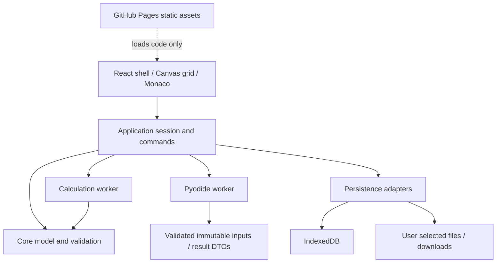

# ExcelLight Web architecture

The React/Vite application opens a dark worksheet backed by the workbook session. Formula semantics and native/XLSX interchange were validated against the desktop implementation; the browser constraints below are deliberate, not placeholders.

## 1. Backend decision

**There is no application backend.** GitHub stores source and runs CI; GitHub Pages serves the static build. React, the spreadsheet engine, file adapters and Python all run in the browser. Workbooks are never uploaded by application code.

Exact desktop process parity is impossible under that constraint: browsers cannot launch arbitrary Windows processes, read arbitrary disk paths, or load arbitrary native CPython wheels. Pyodide is the Python implementation. Scripts that require desktop-only facilities are unsupported and reported as such; the product does not add a backend or claim those scripts work. A backend would also conflict with Pages-only execution and the local-data requirement.

## 2. Stack and alternatives

| Area | Choice | Reason / qualification |
| --- | --- | --- |
| App | React + strict TypeScript + Vite | Static output; typed boundaries |
| Styling | Shared CSS variables, dark only | Black top bars, dark sheet/panels, blue focus; no styling framework |
| Worksheet | Custom virtualized Canvas 2D plus DOM editor and accessible grid projection | Win2D semantics are specialized; the model stays independent of a grid library |
| Model | Pure TypeScript sparse immutable snapshots and command transactions | Ported semantics, not UI framework types |
| Calculation | TypeScript tokenizer/AST, dependency graph and the supported function subset in a worker | ClosedXML is a .NET dependency, not a drop-in JS engine |
| Python | Pinned Pyodide, NumPy, pandas and Matplotlib in a module Web Worker | The shell stays responsive; worker startup does not run workbook source; explicit Agg PNG backend |
| Editor | Lazy-loaded Monaco with locally bundled workers | Source editing, range picking and draft barriers |
| Native format | Version-1 ZIP/JSON adapter with bounded zip.js streaming | Desktop `.exlt` interoperability |
| XLSX | OOXML over zip.js with namespace-aware xmldom for small metadata parts | The desktop-supported subset, including detailed styles |
| Storage | IndexedDB (thin idb adapter); File API download/upload fallback | Browser-local workspaces and portable files; optional File System Access when available |
| Tests | Vitest + Playwright | Domain behavior, actual WASM runtime, browser interactions and static deployment |

The formula and file adapter rationale is recorded in [ADR-003](decisions/ADR-003-formula-and-file-adapters.md).

## 3. Components and dependency direction

`core` imports no React, browser APIs or adapters. `application` depends on core and abstract ports. Calculation, persistence and Python implement ports; `app` wires them. `features` translates UI intent into commands. `grid` owns projection and input, never an independent editable data store. Dependencies must not cycle. Large calculation, decode/encode and Python work must not block input.

## 4. State, history and worker contract

- The model stores plain, deeply immutable snapshots and shares unchanged records across transitions. Callers inject an ID factory. Worksheet view state belongs outside the document. Whole-row, whole-column, and whole-sheet formatting stores `style?: CellStyle` on `AxisDimension` (`sheet.rows` / `sheet.columns`), with effective precedence `cell > row > column`, materialized cross-axis intersection cells (`sheet.cells`), and explicit empty `{}` cell style overrides so single-cell clears stay distinct from inheritance.
- Indexed cell deltas retain sparse cell order for history. Structural proposals carry a detached workbook with the same workbook ID and can be submitted against a captured basis. The session validates the entire proposal before changing live state. The history byte budget counts estimated retained DTO size in both directions, including structural snapshots.
- The session issues a compact, session-scoped source fingerprint and compares authored content exactly when checking saved content. Equality ignores derived caches and the enumeration order of sparse cells, axis dimensions, merge records and filter criteria. A confirmed save records the captured snapshot that completed, even if edits advanced the session. A save from a previous session is ignored.
- Native cache batches use the versioned workbook DTO in `src/application/workbook-protocol.ts`. The session checks the pending request and its full basis, then validates the whole update batch before applying it. Cancel, superseding requests, edits and adoption invalidate pending work. Calculators and persistence adapters operate on detached inputs and report completions to the session. Generated spill cells share `spillOwner` / `spillKind` (`'python' | 'formula' | 'pivot'`) ownership; formula anchors carry derived `spillExtent` and `CacheUpdate.spill` payloads applied atomically without advancing `authoredRevision` or adding undo history, and `spillKind === 'formula'` children are excluded from authored-workbook equality. PivotTable definitions live in optional `WorkbookDocument.pivots` (`src/core/pivot.ts`), evaluate purely in `src/calculation/pivot-engine.ts`, and materialize `'pivot'`-owned cells atomically via `src/application/pivot-commands.ts`.
- Stable workbook/sheet/cell/block/name identities and one-based coordinates are retained. Blank is distinct from empty text, finite number, Boolean, native formula and Python anchor. Authored source stays separate from derived caches and UI view state.
- The session owns document, authored identity, saved identity, monotonic revision and bounded history (100 transactions / 64 MiB). Compound edits, structural changes and Python result generations are atomic. Native cache commits advance the full revision without adding history or advancing the authored revision. Clipboard and deferred structural commands use the authored revision to reject intervening edits and use a fresh snapshot when planning their transaction. Undo never rewinds either revision.
- Workers receive immutable snapshots or validated deltas with `protocolVersion`, `requestId`, `sessionId`, `revision`, `generation`, `sourceFingerprint` and `runtimeFingerprint`. Replies must match the current basis and limits before one transaction commits. Late work after editing, undo, load, cancellation or worker replacement is ignored.
- Source bounds: 10 sheets, 1,048,576 rows × 16,384 columns (`A1:XFD1048576`), 200,000 populated cells, 10,000 formulas. Named definitions ≤1,000. Python input/output ≤100,000 cells, preview ≤500 rows, source/logs ≤1 MiB, messages ≤32 MiB, PNG ≤16 MiB and 16 million pixels, default timeout 30 seconds.
- Serialized outputs use validated plain DTOs, typed arrays and transferable ArrayBuffers, not Node files or Windows pipes. JSON is the transport. Values/nulls/date conversion are preserved independently of transport.

## 5. Calculation and references

English function names and comma separators are canonical; locale presentation only changes actual argument separators. Parsed reference tokens, never search-and-replace strings, drive copy, cut/move, fill, structural edits and rename. Structural edits adjust absolute coordinates too; deleted targets become `#REF!`. Python `xl` literals use syntax-aware source spans.

Explicit error values cover circular dependencies (`#REF!`), malformed source (`#VALUE!`) and unsupported functions (`#NAME?`). IF and IFERROR evaluate their selected branch, while dependency analysis records references in every branch. VLOOKUP supports exact and sorted approximate matching. SUBTOTAL excludes filtered rows and nested subtotals, and codes 101–111 also exclude manually hidden rows. Its filter key uses the shared cell formatter, including locale tags and numeric masks; a format change in a filtered column invalidates affected SUBTOTAL formulas. Filter criteria live on the sheet, so manual row hides stay independent of filtering.

The browser locale supplies numeric and date text coercion for entry. Formula syntax and stored numeric values stay canonical. DATE, NOW, and the date-part/workday functions preserve serial 60. The modular registry under `src/calculation/functions/` implements 225 Excel functions across logical, info, sparse-aware lookup/reference (`XLOOKUP`, `XMATCH`, `INDEX`, `MATCH`, `OFFSET`, `INDIRECT` A1/R1C1), dynamic-array/shaping (`FILTER`, `SORT`, `UNIQUE`, `SEQUENCE`, `RANDARRAY`, `TEXTSPLIT`, stacking/reshaping), conditional/general aggregates (`SUMIFS`, `COUNTIFS`, `AVERAGEIFS`, `MAXIFS`, `MINIFS`, `AGGREGATE`, `SUMPRODUCT`), math/trig/matrix, text formatting, date/time, statistics, and financial TVM/depreciation modules, plus general `:` range composition. Inline array constants and array arithmetic broadcast across scalars, 1×N, N×1, and M×N matrices (`#N/A` on mismatched shapes), and multi-cell results spill atomically into unoccupied worksheet cells (or cache `#SPILL!` on collision with populated cells, merges, Tables, or Python spills). The engine supports `@` implicit intersection, `A1#` spill-range dependencies, structured table references, `LET`, `LAMBDA` (returning `#CALC!` when uninvoked), `ISOMITTED`, `MAP`, `REDUCE`, `SCAN`, `BYROW`, `BYCOL`, and `MAKEARRAY`. The 1904 conversion belongs at the XLSX file boundary.

Native and Python Automatic/Manual settings remain independent. The native scheduler debounces isolated edits by 75 ms and compound or queued edits by 220 ms. It coalesces work while a request is in flight, invalidates a superseded reply, and acknowledges only replies accepted by the session. The module worker keeps an acknowledged graph and calculation state, reuses the graph on literal edits, and traverses dirty ranges and downstream dependencies. Formula topology changes rebuild the graph. TODAY, NOW, and random functions use injected clock/PRNG hooks (`clock`, `random`) evaluated per generation.

Manual edits keep existing results and mark affected formulas stale. Calculate Sheet refreshes the active sheet's formulas and their transitive precedents. Calculate Now refreshes all native formulas. Remaining stale formulas keep their markers. Preferences persist the native calculation mode in browser-local storage. Fresh preferences default both native and Python calculation to Automatic; users may choose Manual independently for either engine. The mixed scheduler pauses native publication while it builds a detached generation, refreshes native prerequisites, runs dependent Python anchors in graph order, replans when spills change topology, then refreshes downstream native formulas and commits one final snapshot. A superseded basis is discarded. Native calculation never starts Python.

Sheet and axis changes are detached session proposals. Whole-axis edits move existing dimensions, merged ranges, filters and defined names with the cells. Lane shifts can split formula ranges into unions. A named extent that becomes disjoint retains its identity and is marked invalid. The same reference transforms apply to Python `xl` literals through a syntax-aware rewrite.

## 6. Python and charts

The port follows `worker/excellite_worker.py` behavior, not its process/file plumbing. Each run has a fresh namespace; literal `xl()` inputs and headers are validated before user statements. The final expression wins over the legacy result assignment. Scalar/Series/DataFrame/2D-array/Figure output is normalized; errors, stdout/stderr, last success, stale states and spill ownership are preserved.

Typing `=PY` or `=PY()` creates one anchor with a stable block identity and an empty source; workbook code remains user-authored. In Automatic mode, opening or importing a workbook forces recalculation of its Python cells, including when saved results appear current, and relevant edits schedule recalculation. Manual mode keeps code inert until Run. The app initializes Pyodide and NumPy/pandas/Matplotlib in a module worker on page load without running workbook source. The Formulas tab exposes the Python panel, which opens automatically for an anchor while ordinary cells clear the editor but leave the panel open. The panel is resizable and hidden from the ribbon or its own Hide action. Monaco is bundled into the lazy panel chunk with its Python grammar, CSS and editor worker; it makes no CDN request.

The panel keeps an editor draft separate from the workbook. Selection, sheet changes, Save/Open/close, history, calculation, structure dialogs, clipboard, Fill/Clear, inline editing, Run and hiding flush a changed draft through a session source command. A newer authored source from undo, adoption or a name/structure rewrite wins over an older draft. Monaco Undo/Redo stays inside the editor.

`src/python/references.ts` lexes Python enough to find and rewrite literal `xl("...")` calls without touching comments, raw or triple-quoted strings and escapes; dynamic or aliased calls are rejected before execution. Copy, cut, Fill and sort translate relative and absolute references; sheet copy/rename/delete and axis/lane changes rewrite source and legacy bindings; name and table renames rewrite name literals. Before a run, `buildPythonInputs` resolves bounded ranges, workbook names and table `[#All]`/`[#Data]` references, snapshots typed values, refuses stale or unverified formula and Python inputs, converts dates and validates headers. Result commit uses `WorkbookSession.tryExecute` against the captured snapshot, so a late worker cannot replace a changed workbook. One session command stores output and spill cells together; failures preserve the last success as stale. Generated cells cannot be edited independently, and clearing or replacing the anchor cleans up the owned spill.

The Python panel exposes Run, Run All, Stop, output/error logs, scalar/table/Figure preview, Copy result and Insert as Values. The worksheet shows a Python block's cached scalar result, `[plot]` for a Figure result, and `=PY()` only when Show Formulas is on. An explicit Manual Run asks once per session before executing workbook code; Trust this session skips that prompt for later manual runs. Automatic mode schedules mixed generations on workbook adoption and relevant edits without a consent prompt. Undo/Redo, selection and editor drafts never execute workbook code. A run does not publish intermediate results; errors retain the last successful result and display stale status. User code can access the network if it requests it.

Production loads the runtime and packages from a versioned same-origin directory staged by the SHA-256-verified build preparation step. The lock pins Pyodide 314.0.8, CPython 3.14.2, NumPy 2.4.6, pandas 3.0.2 and Matplotlib 3.10.8; PyArrow 22.0.0 remains in the lock for the IPC probe. The module worker uses no SharedArrayBuffer. A 30-second run timeout or Stop terminates the worker; the next explicit Run starts a fresh worker. [Runtime lock](../src/python/runtime-lock.json)

The build stages the locked runtime and generates `LICENSES.md` plus the wheel license texts from those exact assets. It emits an integrity manifest for the complete static artifact. The service worker verifies and caches the app shell during install. On page load the app fetches and initializes the Pyodide runtime plus NumPy, pandas and Matplotlib; the shell stays interactive while the worker starts. **Prepare Python for offline use** separately verifies every manifest entry and persists the complete locked asset set in Cache Storage before marking Python offline-ready. First visit and first offline preparation need connectivity. Cache quota, integrity and missing-asset failures leave offline readiness false and can be retried. Workbook data stays in IndexedDB; the service worker never caches workbooks or user Python results.

Charts are PNG figures, not interactive/native Excel charts. The panel preview, Save Image, multiple placements linked to one Python source, cell anchors plus offsets, independent dimensions, eight resize handles with directional cursors, free drag and single-placement deletion are preserved. A placement may cover populated cells; its PNG and geometry do not edit those cells. A deep copy of the retained Matplotlib Figure is redrawn at each placement's bounded pixel size without rerunning analysis or accumulating mutations. The worker retains at most eight Figures in an LRU cache keyed by the initial PNG's SHA-256; this identity exists only for the current worker and is removed before a workbook result is stored. Each placement stores its own rendered PNG fallback and source key. If the worker is live, placement, move and resize redraw at the requested size. After worker loss, first placement and move can use the cached PNG. Resizing requests a Python Run, keeps the requested geometry preview visible while the worker restarts, then redraws and commits the new size only after that run succeeds; this gesture does not show a separate confirmation dialog. Canceling an active run or failed calculation keeps the previous placement. **Rebuild Figure** remains an explicit ordinary Python Run; it may run prerequisites and replaces caches only after the generation commits. Worker termination loses the Figure cache: there are no serialized Figures, pickles, or workbook-supplied restore payloads. Never load pickles from workbook files.

## 7. Files, local storage and privacy

Native `.exlt` v1 contains `manifest.json`, `workbook.json` (with additive optional `names` and `pivots`), `sheets/<guid>.json`; Python metadata, results, spills, table caches, PivotTable cells (`spillKind: 'pivot'`), figure PNGs and placements are embedded in sheet records. `src/persistence/native` maps current and legacy desktop field shapes. Package parsing produces a detached document; callers adopt it into a session only after parsing and validation succeed. Python source is inert and is never executed during package load or save. ZIP validation rejects duplicate, malformed, traversing, nested or over-budget entries before adoption. It enforces 128 MiB compressed, 512 MiB expanded, 32 MiB per entry and 10,000 entries. Workbook and Python bindings, caches, PivotTable definitions, and table dimensions are validated; figure payloads are checked as PNGs, including chunk checksums and bounded decompressed scanlines. [Native package tests](../tests/parity/native-package.test.ts) and [Pivot command tests](../tests/integration/pivot-commands.test.ts) cover web round trips. New incompatible schemas still require a migration/version decision.

XLSX exchange is a separate bounded OOXML adapter (`src/persistence/xlsx`) over zip.js and xmldom; it is not a general Excel round-trip. It enforces the native compressed, expanded, per-entry and entry-count budgets and rejects encryption, renamed macro packages, DTD entities, malformed parts and out-of-bounds documents. Import resolves relationships and content types, shared strings, scalar values, formula source (stripping `_xlfn.` and `_xlfn._xlws.` OOXML prefixes outside quoted strings/sheet names for native evaluation, and re-applying them on export via `xlsx-formulas.ts`) and caches, supported styles/gradients, row/column axis styles, merges, dimensions, freeze and 1904 conversions, reports every reportable loss, and adopts the result as a new native workbook with `source: xlsx` provenance. Unsupported formula text and unverified caches are preserved, never replaced with zero. Export is a reviewed download or save-picker file: it writes shared strings, the supported styles, row/column axis styles with coalesced `<col>` ranges, merges, dimensions, freeze and scalar caches, requests manual recalculation on open, materializes only scalar Python results (code, bindings, trust, tables and figures stay native with a report), and never executes Python or clears the session's dirty state. When the browser exposes `isSameEntry`, Export refuses to overwrite the imported `.xlsx`; the input-element fallback cannot prove file identity. Column widths use the Calibri 11 / 96-DPI approximation; the desktop's ClosedXML reader drops the width attribute its own exporter writes, while this adapter preserves the attribute on import and export.

Three identities are kept separate: authored content, locally persisted snapshot, and exported file snapshot. IndexedDB transactions provide local Save and migration boundaries; optional file handles provide direct Save/Save As after permission. A download fallback cannot confirm the user retained the file or atomically replace a disk destination: it is labeled as an export/download and never claims Windows atomic-write parity. New/Open/Close honor draft flush and Save/Don't Save/Cancel; cancelled pickers, failed persistence and a changed save basis preserve current data and dirty status. Browser tab close offers best-effort `beforeunload`, not an asynchronous custom Save dialog guarantee.

The local adapter keeps package bytes as `ArrayBuffer` values in IndexedDB because WebKit can reject `Blob` records. Its public workspace and recovery records expose `Blob` packages to the native package reader, so browser storage details do not leak into workbook or React state. Existing records are restored from either representation during reads; the v1-to-v2 migration remains transactional.

Recent (up to 10) refers to local workspace records and optional permissioned handles, not arbitrary file paths. An untitled workbook's first Save asks for its browser-local name; that workbook name is separate from sheet tab names. Later Save updates the same local workspace, and local Save As changes its Recent name when a native file picker is unavailable. Recent's Remove action deletes only the IndexedDB workspace and recovery snapshot, after confirmation and after the workbook is closed; it never deletes a disk file. A live lease in another tab prevents removal. The session-scoped lease owner survives a same-tab page reload: `pagehide` marks it suspended before releasing the lease, so the reloaded page does not misidentify the outgoing page as another live tab; the BroadcastChannel probe still distinguishes a duplicate live tab. A resumed background tab atomically reclaims an expired lease if no other tab owns it. Find/Replace histories (15 each), view settings and native/Python mode preferences persist locally.

Storage is origin scoped and subject to quota/eviction/private-mode loss; the app requests persistence where available and shows failures. Export remains the portable backup. Different GitHub project paths on one origin share browser storage permissions: DB/cache names are namespaced per app and path separation is not treated as a security boundary. No analytics, workbook uploads or secrets are placed in build variables.

Pyodide executes workbook code and is **not a security sandbox**: workers may access network and browser capabilities. Automatic is the default calculation mode and runs Python code when a workbook opens and after relevant edits; choose Manual to keep imported source inert until Run. This is not a sandbox or a trust boundary. Workbook text is rendered with escaped DOM APIs, PNGs are validated, and arbitrary output HTML is never rendered. The CSP restricts scripts, workers, images, fonts, frames and application assets to the local app, with the WebAssembly and style allowances required by the UI/runtime. HTTPS and WebSocket connections remain available to Python code. The policy does not isolate hostile scripts.

## 8. Dark UI and accessibility

Existing command families, contextual Table Design, black title/tab/ribbon/formula areas, dark default sheet and panels, blue selection, 26 px rows and 96 px columns at 100% are preserved. Grid zoom 10–400% does not scale the ribbon. There is no Light or Follow System setting. Authored cell colors remain intact, including white fills. Forced-colors accessibility is supported.

The grid uses browser-native two-axis scrolling with a viewport-sized canvas. A shared track map drives rendering, pointer hit testing and keyboard reveal. The map stores uniform row and column runs, so an empty axis does not allocate one object per row. Scroll coordinates inside the axis are content pixels. While that extent fits in 16,777,216 pixels it is also the native scroll offset. The reachable grid is `A1:XFD1048576`. At the default row height the sheet is taller than that cap, so the vertical scrollbar is a fraction of the sheet; the compressed range still places the last row inside the window. The row-number column is measured from the width of the last row label. The semantic grid exposes a bounded set of viewport rows and always mounts its active descendant, even when the user scrolls it out of view. Canvas and chrome use system palette colors in forced-colors mode. Selection, scroll and zoom are view state. Tab moves between cells and Escape then Tab leaves the grid.

F2 and double-click open the inline editor with the cell's existing content selected, matching the desktop grid editor; typed entry still replaces the draft and starts at the end. The formula bar keeps its caret behavior.

Input and scrolling are measured in the real browser instead of around automation round trips: key events are dispatched in-page and the time to the projected active cell or mounted editor is sampled over 20 interactions. Development budgets apply to a 10,000-populated-cell worksheet, not to rendered model limits. Playwright WebKit uses a software rasterizer at 2x device pixels in this environment, so its frame times are recorded as an environment limitation rather than Safari parity evidence.

The row header grows to fit the last row number. Column and row header interiors use single arrows pointing into the worksheet. Header edges use browser resize cursors, pointer capture and a resize guide. Releasing a drag commits one size change for the selected tracks. AutoFit measures displayed values with browser canvas font metrics at 100% zoom. Hidden tracks retain their authored size and are skipped during navigation.

The formula bar and inline editor show the supported function signature for the active caret position, with the active argument highlighted in the current draft. Browser locales with a decimal comma display semicolons between function arguments; the editors convert those separators back to canonical commas on commit while preserving quoted text, sheet names, array constants and reference unions. Formulas and View share the Show Formulas toggle state. The canvas and accessible grid use the same formula display and stale-cell state.

In a native formula operand slot, mouse clicks and drags insert a cell or rectangular reference and outline the picked cells. Picking keeps the original edit target and worksheet selection. A pick can replace a selected reference or the last pick while the caret is still at its end. Cross-sheet picks quote sheet names. An inline draft moves to the formula bar when the user changes sheets, temporarily revealing it if hidden, and Enter or Escape returns to the original sheet.

Canonical Excel format codes live in the existing cell style field. The pure formatter supplies the canvas, accessible grid, AutoFit, Format Cells sample and native filter keys. Untagged formatting follows the desktop invariant display convention. Locale tags use the desktop Gregorian locale catalog for numeric separators and date patterns, with browser date-name data. Temporal editors use the explicit tag or browser locale and preserve the underlying serial, including the hidden day or time fraction. Copy as text keeps canonical source values. Number format changes use session cell transactions and preserve other style fields, formula source and caches. Format Cells snapshots the selection; an untouched number field and Cancel produce no formatting transaction.

Font and Fill tabs share the Format Cells draft and record only edited fields. Gradient and custom color selectors have their own draft lifetime. Format Cells follows the desktop tab order and keeps the tab strip and actions in view while panes scroll; keyboard navigation visits the available panes. A merge proposal and all pending format edits commit as one session transaction after any discard confirmation. Font text in the worksheet, previews and AutoFit uses the browser's local fonts and the app fallback stack; the catalog is curated and accepts typed family names. An unavailable family remains in the authored style. Installed-font enumeration would require an explicit browser permission flow.

The canvas paints solid fills, 8 × 8 pattern tiles, linear gradients and rectangular corner and center gradients; the same fill painter serves the dialog samples. Forced colors switch worksheet and preview rendering to the system palette. Underlines, accounting underlines, strikethrough and script placement use browser text metrics.

Format Painter holds a style-only rectangular snapshot scoped to the current workbook session. An application tiles the snapshot in a selected range or uses its dimensions when given one cell. Each paint is one undo step. The locked tool persists across sheets. Single mode ends after application or when changing sheets. Escape or a new workbook session cancels the tool.

Ribbon presets and border strokes are shared physical segments. Each segment updates both adjoining style faces in one session command. Merged outlines resolve to the anchor. A draft in the Border tab records only edited side groups and shares the Number, Font and Fill confirmation. Explicit perimeter edits update the adjoining faces outside the selection in the same transaction, so outlines stay visible and removable. Adjacent cells keep their other style fields and content. Mixed sides retain prior pens until explicitly edited. Diagonals share a pen.

Stored frozen rows and columns project as pinned bands. Drawing, erasing, canvas previews and hit testing use the same projected coordinates at the current zoom. View → Window authors and clears those boundaries; freeze stays in each sheet's authored state, and the top or first track shortcuts use the same command. The desktop's heavier divider is painted at each pinned edge over content and headings.

Find and Replace are session commands over a captured workbook basis, not React state: `src/application/search-commands.ts` produces ordered matches for a scope, option set and query, and `replaceMatches` revalidates every target before building one transaction for Replace All. Scopes are the active sheet or the workbook, ordered per sheet and then by row or column. The dialog opens on Values and remembers it. Values searches the shared formatted display of every cell, including formula results; Find's Formulas option searches only formula cells and matches their stored source, while the Replace tab keeps the desktop's Formulas-only search over every stored source so constants remain replaceable. Blanks are never matches. Zoom remains view state shared by the dialog, slider, View group and status control; the dialog clamps custom values to 10–400%. Draw, Grid and Erase remain active between gestures and exit on Escape, header use, workbook or sheet change, or a competing formatting tool. The ribbon remembers the last preset or tool separately from the active gesture.

Dialog primary actions sit to the left of Cancel in both visual and keyboard order. Cell editors scroll their text without visible scrollbar controls. Row and column sizing fields retain numeric validation with hidden spin buttons.

Both DOM editors share a cell draft. Selection, worksheet changes and ribbon commands flush a valid draft. A rejected or composing draft keeps its original target. Rich clipboard snapshots stay in page memory. Native clipboard events exchange TSV and a local token when the browser carries it. The ribbon can use the local snapshot or open a paste text dialog if clipboard reads are denied. A cut only removes source cells when its matching rich paste commits. Detached clipboard reads must still match the captured workbook revision and worksheet selection.

Canvas needs a synchronized accessible DOM grid, active-cell announcements, keyboard navigation, editable overlay/IME, focus restoration and dialog focus traps. Cross-sheet range picking, multi-area selection, context actions and browser-reserved shortcut conflicts are tested. Desktop Chrome/Edge are primary; Firefox/WebKit support File API fallback and core workflows. Mobile is a usable narrow layout, not a new touch-first parity requirement.

Merged selections, editing and keyboard navigation normalize to the anchor. Canvas panes project the full merge rectangle before clipping fills, text and diagonals to each pane. The accessible grid exposes the row and column span at the anchor. The same text renderer applies alignment, reading order, wrap, shrink, indent, and stacked or rotated text. Merge Across keeps one value per row. The merge command guards stored table extents and Python anchors, and Python spill admission is validated against merged cells and tables.

Workbook names and table designs live on the immutable document. A name is unique without regard to case, rejects A1, R1C1, R and C identifiers, and refers to one sheet rectangle. Copying a sheet allocates new name identities. Deleting a sheet invalidates names whose extent belongs to that sheet. The native formula engine resolves workbook names and `Table[#All]`/`Table[#Data]` tokens, and Python name literals are rewritten when a name or table changes or is deleted.

A table stores an explicit extent and one of four styles: Blue, Green, Orange or Purple. Header, total, banded-row, banded-column, first-column, last-column and filter-button flags travel with that design. Turning the header off caches the labels and shrinks the extent; restoring it refuses when neighboring values changed. The total row writes `SUBTOTAL` on the last column and refuses occupied cells below the table. Resizing a table with a total row moves that total to the new last row and shifts displaced data rows. An explicit cell fill or font overrides table chrome. A full-selection Delete removes the table definition, its cells and its owned filter; Clear Contents and a partial Delete keep the definition. Funnel buttons render only for a header row whose Filter Button is on, and the sheet filter belongs to the table's input extent.

Insert shows a large Table button. Formulas groups Function Library controls following Excel (`Insert Function` modal dialog with keyword search, category filter, and localized signature preview; `AutoSum`; `Recently Used` backed by IndexedDB top-10 history; `Financial`; `Logical`; `Text`; `Date & Time`; `Lookup & Reference`; `Math & Trig`; and `More Functions` with nested `Statistical` and `Information` submenus), alongside a large Name Manager and a small Define Name menu; choosing any function opens the dark `Function Arguments` dialog with per-parameter inputs, relative worksheet range picking, variadic expansion, and live evaluation previews, while editing formulas (`F2`, double-click, or Formula Bar) highlights referenced worksheet ranges and editor tokens with matching colors. Create Table, New Name, Edit Name and Edit Table use the desktop field order: Name, a static Workbook scope, Comment, and Range or Refers to. Every range control reads `...`; opening it selects the cells in the current refers-to rectangle. Name Manager offers New, Edit and Delete, filters All names, Named ranges and Tables, and keeps Delete disabled for a table. A named range can change its name, comment and refers-to rectangle. Resize Table on the ribbon changes a table extent. OK stays to the left of Cancel. While a range is being picked, Enter accepts the current selection, Escape restores the previous text, and worksheet shortcuts and resize handles stay inactive.

Table Design shows Properties, the three-column style options and the four style previews. The tab is present while the active cell is inside a table. The first visit selects it. Leaving the table hides it and restores the last ordinary tab. Returning selects Table Design again when that tab was last active for the same table; this memory lasts for the page session. The resize grip is the keyboard-focusable corner of the table.

Ribbon groups use the desktop command order and local vector artwork. Browser flyouts use keyboard focus and viewport placement for the same commands. `tests/fixtures/parity/ribbon-order.json` freezes the tab, group and flyout order and is checked in Chromium, Firefox and WebKit, including the nested Format → Hide & Unhide menu, split-control pairing, icon presence and forced-colors layout. A flyout trigger's accessible name includes its visible caption, so the changing Number Format sample satisfies label-in-name. Flyouts use their natural height up to the viewport limit. Dialogs stay modal while their title bars let the user move them within the viewport. The font list uses the curated catalog and typed family entry. The web Lock Format Painter control provides a keyboard path to the desktop double-click behavior.

## 9. GitHub and offline operation

Vite emits static `dist/` with relative URLs (`base: './'`). There is no history routing or server rewrite dependency; navigation stays on the single entry page and hash URLs would be used if needed. Worker/runtime/service-worker paths use the build base or `import.meta.url`. CI verifies root and repository-subpath production serving. Deployment runs from `main` after the same checks via the Pages artifact upload.

The build emits a checksum manifest from the production build and registers a service worker at the configured app base, scoped to `/` or the repository path. It precaches all app assets, including lazy Monaco chunks, then cache-first serves them offline. The app fetches runtime and package files on every page startup; **Prepare Python for offline use** separately stores the verified runtime and bundled license assets in Cache Storage, checking manifest size and SHA-256. The cache name includes the app scope and runtime fingerprint. An interrupted or quota-limited prepare never records readiness; retry resumes verified entries. An offline miss returns an explicit 503 instead of silently claiming the runtime is available.

Updates stay in the waiting state until a user chooses to reload. A dirty initiating tab writes a recovery package before requesting activation; the worker also asks other same-scope tabs to report dirty state and defers activation if another workbook is dirty or unavailable. Existing tabs are not claimed or forcibly reloaded. Shell caches are scoped and old versions are cleaned only when one app tab remains; old Python caches remain until a complete newer runtime is ready. Service workers cannot make first-visit offline use possible. The build reports measured full-site and gzip sizes; verify those against the current Pages budget before release.

## 10. Provenance and open limitations

The desktop application at `C:/Temp/ExcelLight` is the behavioral reference for this port: its architecture, menu structure, design guidelines, Python capabilities, XLSX compatibility notes, formula subset, document model/contracts, native package reader and tests. Captured fixtures in `tests/fixtures` keep their source path, SHA-256 and expected-value provenance. The desktop source itself is not part of this repository, and the C# oracle projects used during the port have been retired; [Known Issues](Known-Issues.md) records what can no longer be re-verified here.

Platform checks used for the design (recheck before a major upgrade): [Vite static deployment](https://vite.dev/guide/static-deploy), [Pyodide module workers](https://pyodide.org/en/stable/usage/webworker.html), [Pyodide interrupts](https://pyodide.org/en/stable/usage/keyboard-interrupts.html), [browser storage quotas](https://developer.mozilla.org/en-US/docs/Web/API/Storage_API/Storage_quotas_and_eviction_criteria), [GitHub Pages limits](https://docs.github.com/en/pages/getting-started-with-github-pages/github-pages-limits). They establish platform capabilities, not this application's compatibility.
